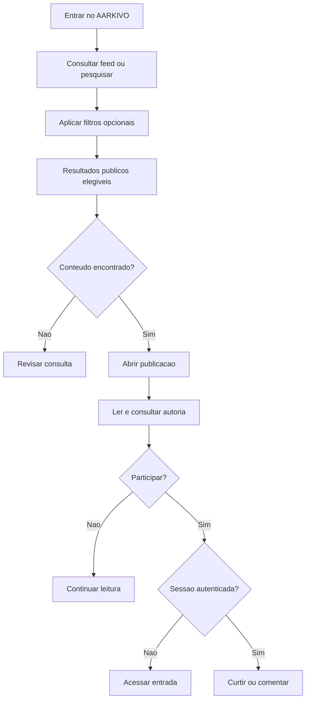
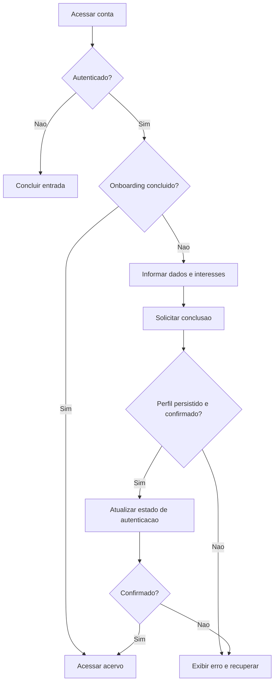
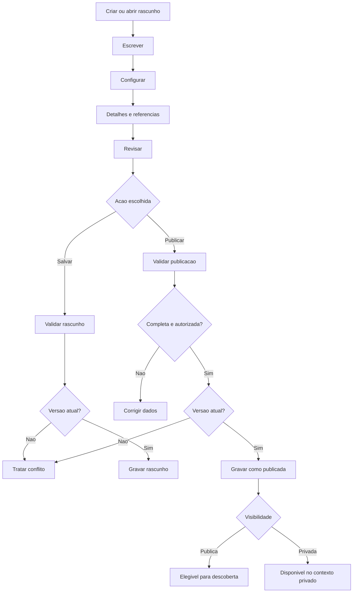
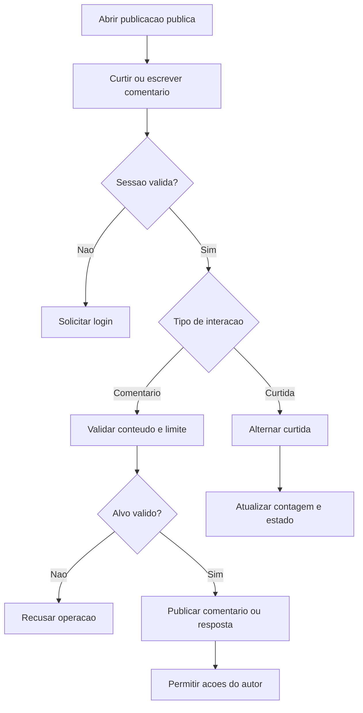
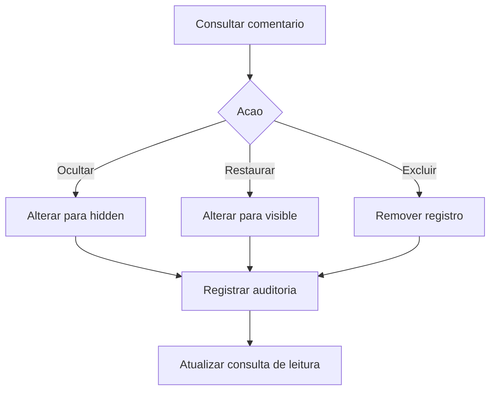
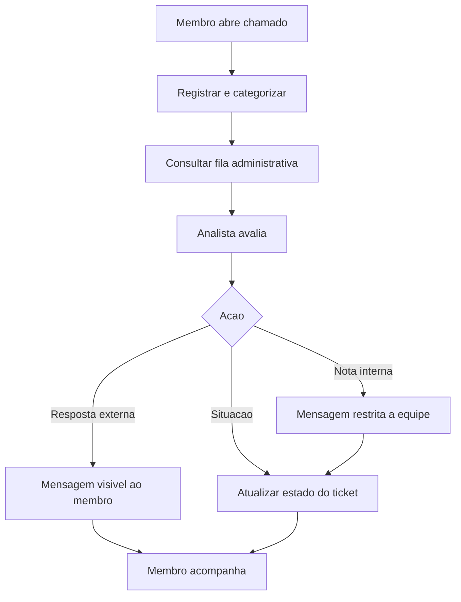

# 04 — Jornadas e fluxos operacionais

Este documento representa a experiência dos atores e as decisões de negócio nos processos do AARKIVO. Fluxogramas descrevem caminhos de referência; a regra verificável está em [Requisitos e regras](03-requisitos-e-regras.md).

## 1. Jornada de descoberta e leitura

**Ator:** visitante ou membro.  
**Objetivo:** localizar publicações públicas e acessar seu conteúdo.

**Controles:** listagens devem filtrar registros publicados e públicos. Leitura não exige sessão; mutações de interação exigem.

## 2. Jornada de ingresso e personalização

**Ator:** pessoa com conta válida.  
**Objetivo:** preparar perfil e interesses para participar do produto.

**Pontos de atenção:** nome de usuário único, associação ao ID da autenticação, erros parciais entre banco e provedor de Auth.

## 3. Jornada editorial do autor

**Ator:** membro autor, com sessão e perfil.  
**Objetivo:** produzir uma publicação e controlar sua disponibilização.

**Regras resumidas:** publicação exige título, resumo, corpo, tipo, rascunho salvo e tags dentro dos limites. O usuário não deve perder conteúdo silenciosamente em conflito de edição.

## 4. Jornada de gestão do acervo

**Ator:** autor autenticado.  
**Objetivo:** localizar, manter, alterar visibilidade ou remover as próprias publicações.

| Ação | Pré-condição | Resultado esperado |
| --- | --- | --- |
| Listar | Sessão válida e perfil existente | Relação dos próprios registros |
| Editar | Propriedade válida | Abrir conteúdo para atualização conforme estado |
| Alternar visibilidade | Publicação em estado `published` | Alternância entre `public` e `private`, com invalidação do acesso público aplicável |
| Excluir | Propriedade ou autorização administrativa | Registro excluído conforme implementação e política a ratificar |
| Retirar/republicar | Estado e versão compatíveis | Nova situação editorial gravada |

**Diferença crucial:** *retirar publicação* altera o estado; *tornar privada* mantém o estado de publicação e restringe sua exposição. Não tratar como sinônimos.

## 5. Jornada de comentários e respostas

**Ator:** membro autenticado.  
**Objetivo:** participar da discussão em uma publicação pública.

**Exceções:** sessão ausente, requisição suspeita, limite de frequência, comentário pai inválido e conteúdo indisponível. Resposta a comentário de outra publicação deve ser objeto de teste negativo específico.

## 6. Jornada administrativa de moderação

**Ator:** administrador autorizado.

As três decisões são distintas e devem possuir autorização e rastreabilidade próprias.

## 7. Jornada de suporte

**Atores:** membro solicitante e analista autorizado.

**Estados disponíveis no código:** novo, em atendimento, aguardando retorno, em desenvolvimento, resolvido e fechado. Um mapa de transições permitido e SLA dependem de aprovação de negócio.

## 8. Critérios de consistência entre jornadas

- Exibição pública nunca revela conteúdo classificado como privado.
- Autorização deve ser aplicada no serviço, não somente nas opções visíveis da interface.
- Salvamento de conteúdo diferencia rascunho, publicação e situação de visibilidade.
- Mensagens internas de atendimento não aparecem na jornada do solicitante.
- Falhas relevantes resultam em resposta compreensível, sem indicação de sucesso falso.

## 9. Interfaces e origens técnicas

| Jornada | Componentes principais |
| --- | --- |
| Descoberta | `src/app/(public)/publicacoes/`, `src/modules/discovery/` |
| Onboarding | `src/app/(public)/onboarding/`, `src/modules/identity/` |
| Composição | `src/app/(public)/escrever/`, `src/components/editor/`, `src/modules/publishing/` |
| Perfil | `src/app/(public)/perfil/`, `src/modules/identity/profile-actions.ts` |
| Interações | `src/components/editorial/comments-section.tsx`, `src/modules/interactions/` |
| Administração | `src/app/admin/`, `src/modules/admin/` |
| Suporte | `src/app/(public)/suporte/`, `src/app/admin/suporte/`, `src/modules/support/` |

Os modelos são representações de processo. Verificação ponta a ponta, estados não previstos e critérios de aprovação ficam sob o [plano de qualidade](07-qualidade-e-operacao.md).
