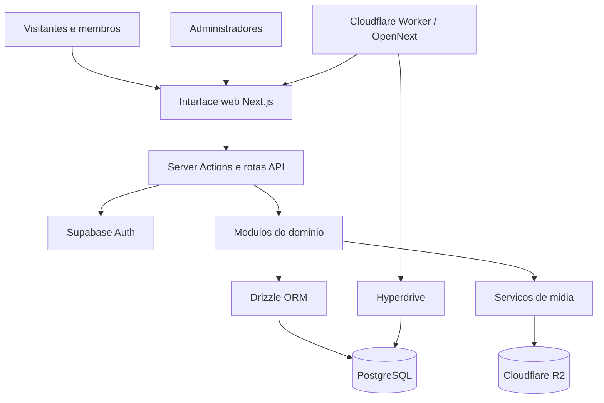
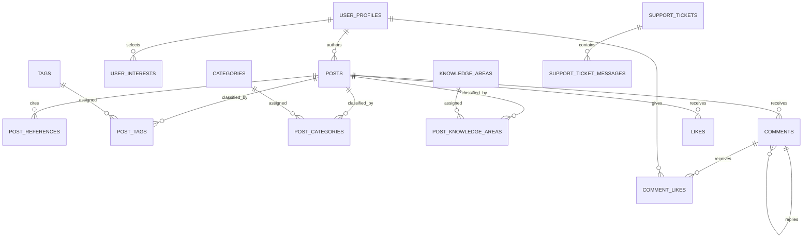

# 05 — Arquitetura da solução e modelo de dados

## 1. Propósito

Descrever a organização técnica e os principais contratos de persistência do AARKIVO. Este documento complementa a [análise de negócios](02-analise-de-negocios.md), que define **o que precisa acontecer**; a arquitetura identifica **onde e como o sistema sustenta essas responsabilidades**.

## 2. Visão da solução

O produto é uma aplicação web baseada em Next.js com App Router. A camada de interface atende leitura pública, funcionalidades de membros e operações administrativas. O servidor executa **Server Actions** e **rotas API**, invocando serviços e repositórios de domínio. Autenticação utiliza Supabase Auth; dados estruturados utilizam PostgreSQL com Drizzle ORM. A configuração de hospedagem inclui Cloudflare Workers, OpenNext, Hyperdrive e R2.

O desenho apresenta a **topologia prevista no código e na configuração**; o ambiente implantado requer evidência operacional própria.

## 3. Stack e tecnologias

| Camada | Escolha observada | Local de referência |
| --- | --- | --- |
| Linguagem | TypeScript | `tsconfig.json`, `package.json` |
| Web | Next.js 16 / React 19 | `package.json`, `src/app/` |
| Autenticação | Supabase Auth com cliente SSR | `src/lib/supabase/`, `src/modules/identity/` |
| Persistência | PostgreSQL, Drizzle ORM, migrações SQL | `src/lib/db/`, `drizzle/` |
| Editor | BlockNote, representação persistente de conteúdo editorial | `src/components/editor/`, `src/modules/publishing/` |
| Objetos e imagens | Interface de mídia e adaptador Cloudflare R2 | `src/modules/media/`, `wrangler.jsonc` |
| Deploy configurado | Cloudflare Worker via OpenNext | `wrangler.jsonc`, `open-next.config.ts` |
| Qualidade | Vitest, Playwright, lint, TypeScript, workflows | `tests/`, `.github/workflows/`, `package.json` |

## 4. Organização do código

| Área | Responsabilidade |
| --- | --- |
| `src/app/(public)` | Páginas e fluxos de navegação, perfil, publicação e atendimento |
| `src/app/admin` | Interfaces protegidas de gestão e moderação |
| `src/app/api` | Endpoints de interação, pesquisa, mídia e suporte |
| `src/modules/identity` | Sessão, perfis, permissões e auditoria |
| `src/modules/publishing` | Domínio e persistência editorial |
| `src/modules/discovery` | Descoberta e consultas públicas |
| `src/modules/interactions` | Curtidas, comentários e moderação |
| `src/modules/taxonomy` | Regras de classificação |
| `src/modules/support` | Tickets, mensagens e atendimento |
| `src/modules/media` | Validação e armazenamento de mídia |
| `src/lib/db` | Conexão, esquema relacional e exportações do banco |

## 5. Modelo conceitual de dados

O banco possui entidades de identidade, autoria, classificação, interação e atendimento.

**Limite do diagrama:** simplificação lógica das relações relevantes. Algumas chaves do esquema são opcionais ou preservam compatibilidade com dados antigos; portanto, o desenho não substitui constraints, cardinalidades condicionais e migrações físicas.

## 6. Entidades e responsabilidades

| Entidade ou associação | Responsabilidade |
| --- | --- |
| `user_profiles` | Identidade pública e vínculo com autenticação |
| `user_interests` | Interesses declarados pelo membro |
| `posts` | Dados, situação editorial, autoria, visibilidade e conteúdo |
| `post_references` | Referências e links associados ao conteúdo |
| `cover_assets` | Metadados de capa |
| `knowledge_areas`, `categories`, `tags` | Classificação temática |
| `post_knowledge_areas`, `post_categories`, `post_tags` | Vínculos entre publicação e classificação |
| `comments` | Comentários, autoria, moderação e resposta a comentário |
| `likes`, `comment_likes` | Interações de curtida |
| `admin_identities`, `audit_events` | Identidade e rastreabilidade administrativas |
| `support_tickets`, `support_ticket_messages` | Solicitações de ajuda e comunicações de atendimento |

A especificação física oficial das tabelas está em [schema.ts](https://github.com/jukazilli/oplib/blob/393f22ab4fa81547bcb6a9db6b5b47c44b4da1aa/src/lib/db/schema.ts). Alterações estruturais são versionadas em `drizzle/`.

## 7. Estados relevantes

**Publicação:** `draft`, `published`, `withdrawn`.  
**Visibilidade:** `public`, `private`.  
**Comentário:** `visible`, `hidden`.  
**Ticket:** `novo`, `em_atendimento`, `aguardando_retorno`, `em_desenvolvimento`, `resolvido`, `fechado`.

Situação editorial e visibilidade são atributos diferentes; a condição de exposição pública combina os dois. As transições permitidas e exceções são descritas em [Requisitos](03-requisitos-e-regras.md).

## 8. Segurança e autorização

1. **Sessão de membro:** servidor consulta a identidade autenticada antes de operações restritas.
2. **Privilégio administrativo:** `identity/access.ts` valida papel em `app_metadata` ou identificador administrativo configurado; `requireAdmin` protege páginas e comandos.
3. **Ownership:** repositórios restringem escrita à autoria identificada, com exceções explícitas de administração.
4. **Leitura pública:** consultas filtração por publicação efetiva e visibilidade pública.
5. **Validação:** contratos de entrada com Zod e regras de domínio protegem operações.
6. **Mídia:** validação de tipo, assinatura e tamanho restringe capas e uploads conforme fluxo.

O cumprimento destas regras no ambiente implantado depende de teste de autorização e revisão dos pontos de acesso.

## 9. Regras técnicas de integridade

- Publicação exige dados obrigatórios antes de ser disponibilizada.
- Referências pertencem a publicações e possuem índice de posição.
- Campos de autoria e de estado possuem vínculos e constraints declaradas no esquema.
- Salvamento/edição utilizam verificações de versão onde implementadas.
- Comentários se relacionam com publicação e podem apontar para um comentário pai.
- Operações administrativas de moderação podem registrar evento auditável.
- Chamados possuem separação de mensagens internas e públicas no serviço de leitura.

## 10. Decisões de arquitetura que devem ser examinadas em revisão

- Completar cobertura de integridade para comentários pai da mesma publicação.
- Conferir política de exclusão definitiva e destinação das mídias relacionadas.
- Validar cenário de atualização parcial entre perfil relacional e Supabase Auth.
- Identificar campos legados no esquema antes de realizar migrações destrutivas.
- Conferir a configuração efetiva do Worker, Hyperdrive, R2 e credenciais por ambiente.
- Testar respostas e políticas de cache em conteúdos privados ou retirados.

Esses tópicos são **pontos de verificação**, não relatos de incidentes reproduzidos.

## 11. Referências operacionais

A execução, testes e verificações ficam em [Qualidade e operação](07-qualidade-e-operacao.md). A ligação entre necessidades, contratos, implementação e validação é estabelecida em [Execução e rastreabilidade](06-execucao-e-rastreabilidade.md).
